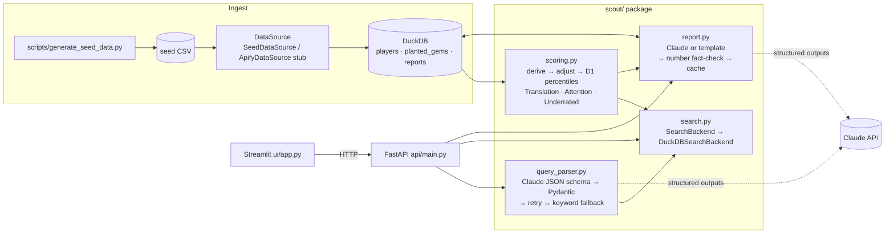

# ScoutAgent

NCAA men's basketball recruiting intelligence that surfaces overlooked players.

A coach types *"Find a D2 point guard who'd translate to D1, strong passer, under 6'3""*.
ScoutAgent parses that into filters, ranks matching players by a transparent
**Translation Score** (would this production hold up at D1?) and **Underrated Score**
(how much better is he than the attention he gets?), and writes a professional
scouting report on demand, fact-checked so it can't invent stats.

**The pitch is recruiting equity.** Attention follows big programs, not performance, so
good players at small schools get missed.

> Practice build for Cal Hacks. The data is **synthetic** (no scraping), with planted
> "hidden gems" so we can check that the scoring actually finds them.

## Architecture



## Setup

```bash
cd scoutagent
python3 -m venv .venv
.venv/bin/pip install -r requirements.txt
cp .env.example .env              # add ANTHROPIC_API_KEY (optional; everything works offline)
.venv/bin/python -m scripts.generate_seed_data
```

## Run (one command per service)

```bash
.venv/bin/uvicorn api.main:app --port 8000          # API, docs at http://localhost:8000/docs
.venv/bin/streamlit run ui/app.py                    # UI at http://localhost:8501
```

If the API runs on another port, set `SCOUT_API_URL` (in `.env` or the environment) for the UI.

Useful scripts:

| Command | What it does |
|---|---|
| `python -m scripts.generate_seed_data` | Rebuild the 600-player dataset and load DuckDB; prints summaries and planted rows |
| `python -m scripts.evaluate_scoring` | Acceptance check (planted gems in top 50) and top 10 with explanations |
| `python -m scripts.try_queries ["query"]` | Parse and search from the terminal |
| `python -m scripts.warm_cache [n]` | Pre-generate reports for the top n players (run before a demo) |
| `pytest -q` | 73 tests: scoring math, parser fallback, report fact-check, API |

### Without an API key

Everything still works. Queries go through the keyword parser and reports come from a
deterministic template. The UI always says which path produced each result. When a key is
added, cached template reports are upgraded to Claude reports on the next request.

## Scoring methodology

All constants live in `scout/config.py` (`SCORING_CONFIG`, `POSITION_WEIGHTS`) and are
**assumptions to tune**, not facts.

1. **Derived stats.** There's no FGA column, so it's recovered from the points identity
   `PTS = 2·FGM + 3PM + FTM`, giving `FGM = (PTS − FTM − 3PM)/2` and `FGA = FGM / FG%`.
   Then TS% = `PTS / (2·(FGA + 0.44·FTA))`, AST/TO, and per-40 rates. 3P% is shrunk toward
   the D1 position average using 50 "phantom" attempts, so a 3-for-5 center doesn't look elite.
2. **Level adjustment.** `multiplier = level_factor × (0.85 + 0.30 × conference_strength)`,
   with D1 1.00, D2 0.80, D3 0.65, NAIA 0.70, so an average conference gives exactly the level factor.
   - Counting stats are multiplied by it; turnovers are divided by it.
   - Efficiency stats can't be scaled (60% × 0.8 = 48% is nonsense), so only the part
     **above** the D1 position average is discounted. Strong numbers against weak competition
     are trusted less; weak numbers get no free pass.
3. **Translation (0–100).** The adjusted stats become percentiles against **D1 players at the
   same position**, then a position-weighted mean. PG weights favor AST/TO, AST per 40, TS% and
   3P%. Bigs favor rebounding, blocks and TS%. Players under 600 season minutes are pulled toward 40.
4. **Attention (0–100).** A percentile blend: 40% recruiting stars, 35% log followers, 25% news mentions (90 days).
5. **Underrated (0–100)** = `(Translation − Attention + 100) / 2`. 50 means fairly rated.
6. **Ranking gate.** When sorting by Underrated, only players with Translation ≥ 50 rank.
   Without it, ordinary players ranked high just for being unknown: 5 of 10 planted
   "volume decoys" reached the top 50. The UI says how many players are hidden and has a toggle to show them.
7. **Explanations.** The top 3 factors are ranked by `weight × (percentile − 50)`. The top
   concern is the weakest stat, including turnover rate.

**Validation on synthetic data:** all 15 planted gems rank in the top 50 (target 10); 4 of 10
decoys do with the gate. This proves the pipeline is wired correctly and the adjustments push in
the right direction. It does **not** prove the weights are right, because the gems were built
with an efficiency edge and the weights reward efficiency. Real validation would need real
transfer outcomes.

## Report fact-check

The report prompt sees only a JSON of pre-rounded facts and must cite only those numbers.
Then `check_numbers()`:

- Extracts every number in the report and drops structural ones (D1, per 40, 3-and-D, 90 days).
- Checks each remaining number against the input at the report's own precision
  (61.6% may be written as 62%), plus percentile complements ("top 1%").
- Requires heights to match exactly.

If anything is flagged or a section is missing, Claude gets one retry with the problems listed.
Anything still flagged is shown in the UI as a warning. All 600 template reports pass, and planted
fakes (`31.7 PPG`, `6'4"`) are caught.

## Known limitations

- **Synthetic data.** Names and schools are generated; any resemblance is coincidental.
  Distributions are plausible but not calibrated to real NCAA data.
- **Weights and level factors are judgment calls**, untested against real outcomes.
- **One season, box-score only.** No tracking data, schedule strength beyond a conference
  number, age, injuries, or film.
- **Attention data is simplistic.** Real followers and news counts would need their own sources.
- **The fact-check is numeric only.** It can't catch a wrong *claim* written without a number
  ("elite defender"), or a real player's name in the archetype.
- **The keyword fallback is regex-based.** It handles common phrasings, not everything Claude can.
- **The real-LLM path wasn't exercised in this build** (no key during development). It's
  covered by mocked tests; run `try_queries` and generate a report once a key is set.

## Lessons for the real event

**What took longest**
1. **Scoring calibration**, not code. Making Underrated mean "good *and* overlooked" rather
   than just "overlooked" needed the decoys and the gate. Budget real time for this, and plant
   decoys from the start.
2. **Fact-check false positives.** Numbers like "90 days" and "3-and-D" flagged clean reports.
   Run the checker on every template output early; it surfaces these in seconds.
3. **Natural-language edge cases.** "Translate to D1" is not a D1 filter. Heights come as 6'3",
   6-3, 6’3” and "or shorter". Write these as parametrized tests first.
4. **Streamlit state.** Callbacks, `session_state` and dataframe row selection take some
   getting used to.

**Pre-learn before Cal Hacks**
- Claude structured outputs (`output_config.format` with a JSON schema). Current Sonnet/Opus
  reject *forced* tool use, so don't plan on `tool_choice` for JSON.
- Streamlit `st.dataframe(on_select="rerun")`, `st.form`, button callbacks, `st.cache_data`.
- FastAPI app factory plus `TestClient`, so tests can inject a backend and a temp DB.
- DuckDB `register()` for SQL over a pandas DataFrame, and its single-writer file lock
  (keep file connections short-lived).

**Cut first if time is short**
1. The FastAPI layer. Streamlit can import `scout` directly, which saves roughly an hour of
   plumbing and one process to keep alive.
2. Skill-emphasis re-ranking and the "include gated" toggle.
3. The LLM query parser. The keyword parser plus example buttons carries a demo.

Never cut the **template report fallback** or the **report cache**. They're what keep a live demo alive.
