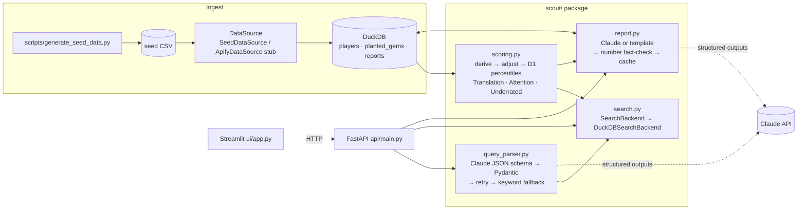

# ScoutAgent

A search tool for finding NCAA men's basketball players that recruiters overlook.

You type something like "Find a D2 point guard who'd translate to D1, strong passer, under 6'3"." ScoutAgent turns that into filters and ranks the matches with two scores. Translation asks whether a player's production would hold up at D1. Underrated asks how much better he is than the attention he gets. Click a player and it writes a scouting report, then checks every number in the report against his data so the model can't make up a stat.

The idea behind it is simple. Attention follows big programs, not performance, so good players at small schools get missed.

This started as a practice build for Cal Hacks. All the data is synthetic, because most stats sites don't allow scraping. The generator plants 15 hidden gems, which gives the scoring something to be tested against.

## How it fits together



## Setup

```bash
cd scoutagent
python3 -m venv .venv
.venv/bin/pip install -r requirements.txt
cp .env.example .env              # add ANTHROPIC_API_KEY if you have one; the app works without it
.venv/bin/python -m scripts.generate_seed_data
```

## Running it

The API and the UI are separate processes. Start each in its own terminal and leave both running.

```bash
.venv/bin/uvicorn api.main:app --port 8000          # API, docs at http://localhost:8000/docs
.venv/bin/streamlit run ui/app.py                    # UI at http://localhost:8501
```

If the API is on another port, set `SCOUT_API_URL` for the UI.

| Command | What it does |
|---|---|
| `python -m scripts.generate_seed_data` | Rebuilds the 600-player dataset and loads DuckDB. Prints summaries and the planted rows. |
| `python -m scripts.evaluate_scoring` | Checks how many planted gems land in the top 50, and prints the top 10 with explanations. |
| `python -m scripts.try_queries ["query"]` | Parses and searches from the terminal. |
| `python -m scripts.warm_cache [n]` | Writes reports for the top n players ahead of a demo. |
| `python -m scripts.import_synergy_pdfs <folder> [--load]` | Reads real Synergy PDF exports (Overall and play types), checks them against the rules, and shows what they imply about the RATING cutoffs. |
| `python -m scripts.load_real_players --pdfs <folder> --template data/roster.csv` | Makes a roster CSV, pre-filled from the exports. |
| `python -m scripts.load_real_players --pdfs <folder> --roster data/roster.csv` | Loads real players from the roster and exports, scores them, and previews the rankings. |
| `SCOUT_DATASET=real uvicorn api.main:app --port 8000` | Runs the API on real players instead of synthetic ones. |
| `python -m scripts.validate_transfers --simulate` | Self-test of the transfer check on simulated data with known level factors. |
| `python -m scripts.validate_transfers --transfers data/transfers.csv` | Checks the scoring against real players who moved up to D1. |
| `pytest -q` | Runs the 136 tests. |

### No API key

Everything still runs. Queries go through a keyword parser and reports come from a fixed template. The UI says which one produced each result. Once you add a key, cached template reports get replaced with Claude reports the next time someone asks for them.

## How the scoring works

Every constant lives in `scout/config.py` (`SCORING_CONFIG` and `POSITION_WEIGHTS`). They're guesses that are likely to change, not facts.

1. **Derived stats.** The data has no field-goal-attempts column, so FGA is recovered from the points identity. Points are 2 × FGM + 3PM + FTM, which gives FGM = (PTS − FTM − 3PM) / 2 and FGA = FGM / FG%. From there it computes true shooting (TS% = PTS / (2 × (FGA + 0.44 × FTA))), assist-to-turnover, and per-40 rates. Three-point percentage is pulled toward the D1 position average using 50 phantom attempts, so a center who went 3-for-5 doesn't look like an elite shooter.

2. **Level adjustment.** The multiplier is `level_factor × (0.85 + 0.30 × conference_strength)`. The level factors are D1 1.00, D2 0.80, D3 0.65 and NAIA 0.70, and an average conference leaves the level factor unchanged. Counting stats are multiplied by it and turnovers are divided by it. Percentages can't simply be scaled (60% × 0.8 = 48% makes no sense), so only the part above the D1 position average gets discounted. Strong numbers against weak competition are trusted less, and weak numbers get no free pass.

3. **Translation (0 to 100).** Adjusted stats become percentiles against D1 players at the same position, then a weighted average. Percentiles always read as higher is better. For turnovers and points allowed, the percentile is the share of D1 players he beats.
   - 68% comes from the box score. Point guards lean on assist-to-turnover, assists per 40, TS% and 3P%. Bigs lean on rebounding, blocks and TS%.
   - 32% comes from Synergy: points per possession (10%), shot-making over expected (8%), turnover rate (4%) and points allowed per possession on defense (10%). Small samples are pulled toward the D1 average first, using 50 phantom possessions on offense and 100 on defense.
   - Players without Synergy data are scored on the box-score part alone.
   - Players with under 600 season minutes are pulled toward 40.

4. **Attention (0 to 100).** A blend of percentiles: 40% recruiting stars, 35% log followers, 25% news mentions over 90 days.

5. **Underrated (0 to 100)** is `(Translation − Attention + 100) / 2`. A score of 50 means fairly rated.

6. **Ranking gate.** When sorting by Underrated, only players with Translation of at least 50 are eligible. Without this, unknown players ranked high just for being unknown, and 5 of the 10 planted decoys reached the top 50. The UI says how many players are hidden, and the Options menu can show them.

7. **Explanations.** The top three factors are ranked by `weight × (percentile − 50)`. The top concern is the weakest stat, turnover rate included.

**What the validation shows.** All 15 planted gems rank in the top 50 (the target was 10), and with Synergy stats they all sit in the top 16. Box score alone left two at #18 and #29. Four of the 10 decoys still reach the top 50 with the gate on. This shows the pipeline is wired correctly and the adjustments push the right way. It doesn't show the weights are right. The gems were built with an efficiency edge, and the weights reward efficiency, so passing was always likely. Checking them properly takes real data on players who moved up a level, which is what the transfer check below is for.

## Checking the scoring against real transfers

The planted-gems test can't tell you whether the weights or level factors are right. Players who actually moved from D2, D3 or NAIA up to D1 can. `scripts/validate_transfers.py` takes one row per move-up (his last small-school season and his first D1 season) and answers two questions.

**Are the level factors right?** For each division it compares the production that actually carried over to D1 with what the factors predicted, and suggests a corrected factor with a 95% interval. It also accounts for the conference he came from and the one he joined.

**Does Translation predict who succeeds?** It reports the rank correlation between his pre-transfer scores and two D1 outcomes: minutes per game (the coaches' verdict) and D1 production. Translation is compared against raw points per game and against itself with the level adjustment turned off. The minutes result is the one to trust. D1 production reuses the Translation formula, so Translation has a built-in edge there.

Before trusting it on real data, the harness was tested on simulated transfers from a world where the true factors were deliberately different from the config (D2 0.72, D3 0.58, NAIA 0.66, against configured 0.80, 0.65 and 0.70). It suggested 0.707, 0.589 and 0.651, and each true value sat inside its 95% interval. Run `python -m scripts.validate_transfers --simulate` to see it.

To run it on real players:

1. `python -m scripts.validate_transfers --template data/transfers.csv` writes an empty file with the 36 columns. `docs/transfers_example.csv` shows two made-up rows, including how to enter a player who never got on the floor at D1.
2. Fill in real move-ups. Transfer-portal lists show who went where, and each school's athletics site has season stats. Copy them by hand or export them from Synergy; don't write a scraper. Aim for at least 15 players per division, because fewer than that and the intervals are too wide to mean much, and the report says so.
3. `python -m scripts.validate_transfers --transfers data/transfers.csv` prints the report.

Two things will bias the result, and the report says so. Players who barely played at D1 drop out of the level-factor check, which makes the factors look better than they are. And only the players good enough to move up are in the data at all, which narrows the range and pulls the correlations down.

## Synergy-format data

Each player has offense and defense tables laid out like Synergy's Player Details > Overall export. That's 12 situations (All Possessions, Transition, Half Court, Out of Bounds End and Side, After Time Outs, Last 4 Sec., against Man and Zone, and Press with its splits) across 22 columns: POSS, %TIME, %TIME RANK, PTS, PPP, PPP RANK, RATING, FG ATT/MADE/MISS, FG%, EFG%, SSQ, PPS, SSM, TS%, TSA, TO%, %FT, FTA/FGA, %SF and SCORE%. Only the layout came from a real export. There are no real numbers in this repo.

- **Synthetic tables.** `scout/synergy.py` builds integer counts from each player's season totals and splits them into situations. The tables follow every rule found in real exports: PPP = PTS / POSS, SSM = PPS − SSQ, TS% = PTS / (2 × TSA), %TIME = POSS / parent, Transition plus Half Court equals All, Man plus Zone equals Half Court, and To Transition plus To Half Court equals Press. `check_identities()` verifies all 14,400 rows on every rebuild.
- **Real exports.** Save a player's Overall page (offense and defense) as a PDF into a folder outside the repo, then run `python -m scripts.import_synergy_pdfs <folder>`. It parses each file and checks the same rules. With `--load` it stores the tables in DuckDB. The `data/` folder and `*.pdf` are both gitignored. On real exports it found zero rule violations.
- **Play types.** Each player also has offense and defense play-type tables: Transition, Spot Up, P&R Ball Handler, Isolation, Post Up, P&R Roll Man, Cut, Off Screen, Hand Off, Offensive Rebound and Miscellaneous (defense has no Transition). They add up exactly to All Possessions, the mix depends on position, and cuts, roll men and putbacks never take threes. The layout is an assumption: no real play-type export has been checked yet, so it's guessed to match the Overall view. The parser also accepts alternate names like "Post-Up", "Putbacks" and "Misc". Reports mention a player's three most-used play types.
- **RATING cutoffs.** They live in `config.SYNERGY_RATING_CUTOFFS` (Excellent at 85 and up, Very Good 65, Good 45, Average 30, Below Average 10). Synergy's public docs confirm the six tiers and the 10-possession minimum for ranks, but not the cutoffs. So `import_synergy_pdfs` prints the range each cutoff has to fall in, given every rank and rating pair in your exports, and lists any rating the current cutoffs get wrong. The two exports used so far put Excellent between 80 and 89 and Below Average between 2 and 26. More exports will narrow that.

### Real players: roster plus exports

The Overall export has no height, position, division, minutes or rebounds, so real players need a roster CSV (`scout/roster.py`).

1. `python -m scripts.load_real_players --pdfs <folder> --template data/roster.csv` writes one row per exported player. Synergy fills in games, points per game (PTS / games), FG%, free throw attempts per game ((TSA − FGA) / 0.44), FT% ((PTS − PPS × FGA) / FTA) and turnovers per game (TO% × POSS).
2. Fill in the blanks: height (6'2", 6-2 or 74), position, division, conference, minutes, rebounds, assists, steals, blocks, 3PA and 3P%. Conference strength defaults to 0.5. The attention columns are optional. A blank means unknown, not zero, and Underrated shows "n/a" instead of rewarding missing data.
3. `python -m scripts.load_real_players --pdfs <folder> --roster data/roster.csv` validates everything and names every blank cell it finds. Then it stores the players and prints their rankings.
4. `SCOUT_DATASET=real uvicorn api.main:app --port 8000` serves them, and the UI shows a "Real players" pill.

Percentiles need D1 players to compare against, so real players are measured against the synthetic D1 pool until real D1 data is loaded. The UI, the explanations and the reports all say so.

The Synergy ranks shown in the app are percentiles across all 600 synthetic players with no level adjustment, the way Synergy does it. Scoring uses its own level-adjusted D1 percentiles.

## UI design

The Streamlit UI (`ui/app.py`, styles in `ui/style.css`) follows Apple's interface principles.

- The path is search, shortlist, player. The shortlist and the player sit side by side and the top match opens on its own. Synergy tables and the report sit one level down behind a segmented control, and the gate option lives in an Options menu.
- Text uses the system font, with tight spacing on the big headline, normal spacing on body text, and tabular numbers so stats line up.
- The search bar floats as a blurred, translucent layer that content scrolls under. Cards are soft fills, not boxes.
- The example searches rotate. A fresh page always shows the same three, so demos are predictable. After each search, or when you click More ideas, they swap to others from a pool of 14 that each show something different the search understands (a messy request, a height range, "D1-ready" sorting, a school name). Every one was checked to return real results.
- Buttons shrink slightly when pressed. Status shows up as small pills colored by meaning (green for fact-checked, orange for a concern, red for unverified) instead of full-width alert boxes.
- Colors are Apple's system colors for light and dark, set in `.streamlit/config.toml`, so the app follows your OS setting. Surfaces take their tint from the text color, so they stay readable even if Streamlit's theme and the OS disagree.
- The list and player stack when there isn't room for both, and the metric tiles wrap instead of truncating.
- It respects reduced motion, reduced transparency and higher contrast settings, and buttons are at least 44pt tall.

## The report fact-check

The report prompt sees only a JSON of pre-rounded facts and must cite only those numbers. Then `check_numbers()` runs over the output:

- It pulls out every number and ignores ones that are part of a name or phrase, like "D1", "per 40", "3-and-D" and "90 days".
- It checks each remaining number against the input at the precision the report used, so 61.6% can be written as 62%. Percentile complements like "top 1%" are allowed.
- Heights have to match exactly.
- Spelled-out numbers count too. "Eight" has to round from a real value such as 7.6.
- Fractions and multiples ("a third", "twice", "half of") are always flagged, since the data never contains them and a writer only gets one by doing math.

`check_comparisons()` flags sentences that rank the player against people outside his data, like "the steepest discount on this board" or "best shooter in the conference". Each report sees one player, so it can't support those claims. Comparing him to D1 percentiles is fine.

If anything is flagged or a section is missing, Claude gets one retry with the problems listed. Anything still flagged shows up in the UI as a warning. All 600 template reports pass, and planted fakes like `31.7 PPG` and `6'4"` get caught.

**A test round.** Claude wrote reports for the top five players from the exact inputs the app would send. All five passed the original digit-only check. Reading them by hand turned up an invented fraction ("usage drops by a third") and six comparisons to other players, one of them false: it called a 0.74 multiplier the steepest when another player's was 0.69. Those sentences are now regression tests in `tests/test_report.py`.

## Known limitations

- The data is synthetic. Names and schools are generated, and any resemblance to real ones is coincidence. The distributions look plausible but aren't calibrated to real NCAA data.
- The weights and level factors are judgment calls that haven't been tested against real outcomes.
- It's one season of box-score and Synergy stats. There's no tracking data, no schedule strength beyond one conference number, and nothing on age, injuries or film.
- The attention data is crude. Real follower and news counts would each need their own source.
- The fact-check works by pattern. It catches wrong numbers and out-of-scope rankings. It won't catch a wrong claim that has no number in it ("elite defender"), or a real player's name in the archetype. A spelled-out number also passes if any value in the input rounds to it, so "thirty-four" slips through when he plays 33.5 minutes. The word checks catch most invented numbers, but not all.
- The keyword fallback is regex-based. It handles common phrasings and nothing like the range Claude can.
- The Claude paths have never run against the real API, because there was no key during development. Mocked tests cover them. Once you have a key, run `try_queries` and generate a report to see them work.

## Lessons for the real event

What took longest:

1. Scoring calibration, not code. Making Underrated mean "good and overlooked" instead of just "overlooked" took the decoys and the gate. Plant decoys from the start and leave real time for this.
2. False positives in the fact-check. Numbers like "90 days" and "3-and-D" flagged clean reports. Run the checker over every template output early and these show up in seconds.
3. Natural-language edge cases. "Translate to D1" isn't a D1 filter, and heights come as 6'3", 6-3, 6’3” and "or shorter". Write these as parametrized tests first.
4. Streamlit state. Callbacks, `session_state` and dataframe row selection take some getting used to.

Worth learning before Cal Hacks:

- Claude's structured outputs (`output_config.format` with a JSON schema). Current Sonnet and Opus models reject forced tool use, so don't plan on `tool_choice` to get JSON.
- Streamlit's `st.dataframe(on_select="rerun")`, `st.form`, button callbacks and `st.cache_data`.
- A FastAPI app factory with `TestClient`, so tests can inject a backend and a temp database.
- DuckDB's `register()` for running SQL over a pandas DataFrame, and its single-writer file lock. Keep file connections short.

What to cut first if time runs short:

1. The FastAPI layer. Streamlit can import `scout` directly, which saves about an hour of plumbing and one process to keep alive.
2. Skill-based re-ranking and the "include gated" option.
3. The Claude query parser. The keyword parser plus example buttons is enough for a demo.

Don't cut the template report fallback or the report cache. They're what keep a live demo from dying.
